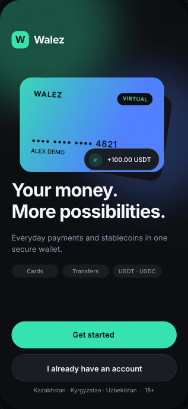
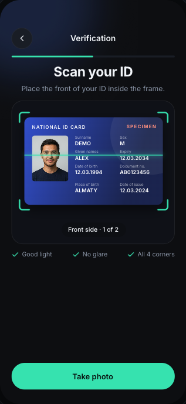
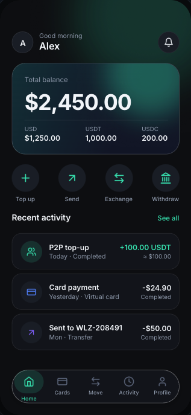
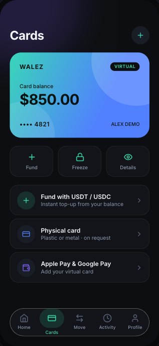
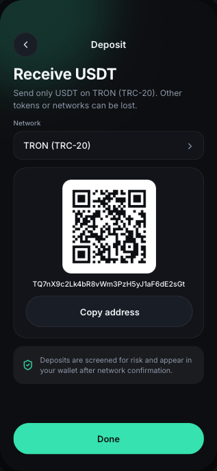

<div align="center">

<a href="https://symplr.io">
  <picture>
    <source media="(prefers-color-scheme: dark)" srcset="docs/symplr-logo-dark.png">
    
  </picture>
</a>

# Walez

**A digital wallet app generated by [Symplr.io](https://symplr.io) from a Figma design.**<br>
Real Expo React Native source code, in strict TypeScript.

<a href="https://symplr.io/demo/walez"></a><br>
<sub>Cmd/Ctrl-click to open it in a new tab.</sub>

[](https://sonarcloud.io/summary/overall?id=Symplr-io_walez-demo)
[](https://sonarcloud.io/component_measures?id=Symplr-io_walez-demo&metric=coverage)
[](https://github.com/Symplr-io/walez-demo/actions/workflows/quality.yml)
[](LICENSE)







</div>

## Try it in your browser

Open **[symplr.io/demo/walez](https://symplr.io/demo/walez)** (Cmd/Ctrl-click for a new tab). No install and no account needed.

1. The page opens on the app's Blueprint, the map of its screens in Symplr.io. Click a screen to see what is on it.
2. Press **Run** to use the app itself. It starts on the Welcome screen.
3. Tap **Get started** to walk through sign-up and identity checks: country, account, phone code, citizenship, ID scan, selfie and review.
   Or tap **I already have an account**, then **Log in**, to go straight to Home.

From Home, try topping up by card or P2P, receiving USDT, sending money, converting, withdrawing, and the virtual card: freeze it, see its details or add it to Apple Pay and Google Pay.
The app has no backend: names, amounts and statuses are the design's sample values.

**Build your own with Symplr** gives you a copy of the app to change, once you sign up.

## Made with Symplr.io

<p align="center">
  
  &nbsp;→&nbsp;
  
  &nbsp;→&nbsp;
  
</p>

Symplr.io turned the Figma design into the app in [`apps/walez`](apps/walez):

- **61 screens** from the Figma frames, with navigation, tabs and deep links.
- **The design's prototype links** as the app's navigation.
- **Design tokens** taken from Figma, with NativeWind for code you add.
- **Quality built in:** 851 unit tests, ESLint, strict TypeScript, and a
  SonarQube Cloud setup.

A few small fixes were made by hand after generation. Each one is its own
commit in the history.

**Have a design of your own? [Turn it into an app at symplr.io →](https://symplr.io)**

## For developers


Run it yourself with Node 22 and Expo Go:

```bash
git clone https://github.com/Symplr-io/walez-demo.git
cd walez-demo/apps/walez
npm ci
npm start        # then scan the QR code in the terminal with Expo Go
```

The phone and the computer need to be on the same network.

| Command | What it does |
| --- | --- |
| `npm start` | Starts the Expo dev server |
| `npm run typecheck` | Type-checks with `tsc` |
| `npm run lint` | Runs ESLint |
| `npm test` | Runs the Jest unit tests |
| `npm run test:coverage` | Runs the tests and writes the coverage report |

| Path | What is there |
| --- | --- |
| [`apps/walez`](apps/walez) | The app: generated code in `src/gen`, your own code in `src/custom` |
| [`.github/workflows`](.github/workflows) | The quality checks on every push |

## Quality

Every push to `main` runs these checks:

| Type check | Lint | Unit tests | Coverage | SonarQube Cloud |
| :---: | :---: | :---: | :---: | :---: |
| 0 errors | 0 errors | 851 passing | 87% | Quality gate passed, A ratings |

## Credits

The UI comes from the Figma design "Walez – Digital Wallet (mobile)".

The code is released under the [MIT License](LICENSE).
